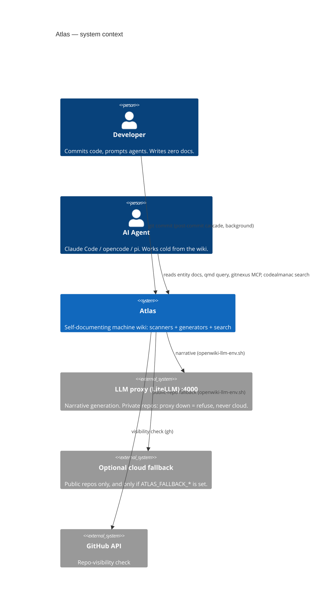
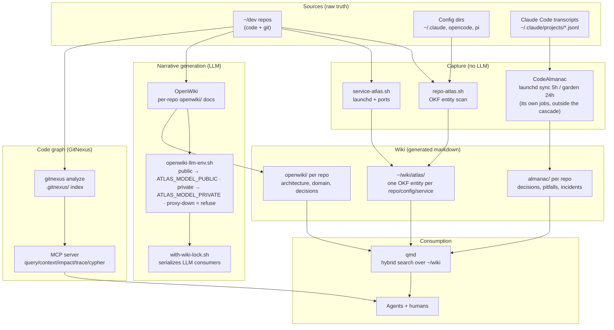
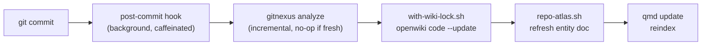

# Architecture

Atlas makes every repo and config dir on one machine document itself — facts, code, data —
well enough that any AI agent or human works in it cold. Zero manual docs; hooks and
launchd loops update everything. Full rationale and phases.

## System context (C4)



## Components



The wiki is a **cache over expensive context re-derivation**; judge it by cache-hit quality.
The entity graph is the markdown itself: `[[wikilinks]]` + OKF frontmatter + `topics.yaml`.
No second graph database and no Graphify-style layer.
GitNexus already is the code graph, and the markdown is the entity graph.

## Post-commit cascade

A **source commit** in any onboarded repo is the trigger that keeps its documentation
fresh. Runs in the background via `core.hooksPath` — never blocks the commit.



`with-wiki-lock.sh` holds a machine-wide lock so concurrent local generations never
contend for the LLM stack. `openwiki-llm-env.sh` picks the provider per repo
visibility: public → proxy model `$ATLAS_MODEL_PUBLIC`, private → proxy model
`$ATLAS_MODEL_PRIVATE`. Proxy down for a private repo → generation refused (loudly,
to `fallback.log`). Proxy down for a public repo → the optional
`ATLAS_FALLBACK_URL/_KEY/_MODEL` endpoint if all three are set, otherwise refused.
Each cascade run also deletes the GitHub Actions workflow OpenWiki scaffolds
(`.github/workflows/openwiki-update.yml`), a cloud refresh path that would bypass
the local env routing and send private content to the vendor default model. GitHub
Actions is therefore never the canonical refresh for Atlas repos; the local
post-commit cascade and the launchd scans are.

## GitNexus CLI surface

Atlas uses `gitnexus analyze` in the cascade plus the MCP server. The full installed
surface, as of the version pinned in `.tool-pins/gitnexus`:

| Area | Commands |
|---|---|
| Index | `analyze` (incremental; `--force`, `--repair-fts`, `--pdg` opt-in, `--embeddings`), `status`, `index` (register existing `.gitnexus/`), `clean`, `remove`, `list` |
| Runtime | `doctor` (platform/embedding capabilities), `embeddings` (on-demand local embedding runtime), `serve`, `eval-server` |
| MCP | `mcp` (stdio; `--http` for remote) |
| Knowledge graph | `query`, `context`, `impact`, `trace`, `cypher` |
| Change analysis | `detect-changes` (map git diff → affected flows), `check` (structural checks, cycles) |
| Cross-repo | `group` (create/add/remove/list/status), `group sync` + `group contracts` (Contract Registry), `group impact`, `group query` |
| Misc | `wiki` (graph → repo wiki; **not** Atlas's narrative path), `setup`, `uninstall`, `augment`, `publish` |

PDG (`analyze --pdg`, control-flow graph + taint dataflow) is opt-in; Atlas's cascade
runs the default index. No second graph/analysis layer is needed. GitNexus is the
code graph, OpenWiki is the narrative generator, and they don't overlap.

## Recursion boundary

Atlas avoids a self-documentation loop by never re-ingesting its own output:

- `.openwikiignore` (seeded by `atlas onboard`, also present in this repo) excludes
  `openwiki/`, `almanac/`, `.gitnexus/`, build artifacts (`node_modules/`, `.venv/`,
  `dist/`, `build/`, `coverage/`, …), lockfiles, and `.env*` from the OpenWiki scan.
- Generated output (`~/wiki/atlas/`, per-repo `openwiki/` and `almanac/`) is data,
  not source. The cascade writes it locally and never commits it; a human reviews
  and commits generated docs, with a leak check for public remotes.
- `repo-atlas.sh` regenerates entity docs from the source repos (`~/dev`), never from
  the wiki itself, so stale generated pages can't feed back into generation.

## Onboarding a virgin repo

`atlas onboard <repo>` (bin/atlas → scripts/atlas-onboard.sh) runs the same steps once, idempotently:
hooksPath → `gitnexus analyze` → `openwiki code --init` → `codealmanac init` →
`repo-atlas.sh` → verify. One command, the repo self-documents from then on. `--undo`
detaches the hook and keeps the inert generated artifacts.

## Capture vs generation

| Layer | Tool | LLM | Cadence |
|---|---|---|---|
| Repo entity scan | `repo-atlas.sh` | none | post-commit + weekly launchd (Sun 04:30) |
| Service entity scan | `service-atlas.sh` | none | weekly launchd (Sun 05:00) |
| Narrative wiki | OpenWiki | via LiteLLM proxy; private repos never leave it | post-commit, locked |
| Transcript mining | CodeAlmanac | its own runner | launchd sync 5h / garden 24h (its own jobs) |
| Almanac → entity fold | `almanac-fold.sh` | none | inside every `repo-atlas.sh` run |
| Drift gate | `atlas check` | none | on-demand, read-only |
| Code graph | GitNexus | none | `analyze` in cascade + on-demand MCP, no persisted facts |
| Run manifests | `atlas-run-state.sh` | none | every run, atomic JSON under `$HOME/.local/state/atlas/runs/` |

Capture is urgent (transcripts and prompts are lost otherwise). Integration into the
OKF entity docs: `almanac-fold.sh` folds the top 5
decisions and top 5 pitfalls/incidents (title + summary, recency-ranked, no LLM) into
each entity doc — a pointer index, never a raw almanac dump.

## Run manifests

Every atlas-run process writes one JSON file per run under
`$HOME/.local/state/atlas/runs/` via `scripts/atlas-run-state.sh`
(`begin`/`finish`/`reconcile`/`prune`/`run`). The OpenWiki cascade writes a
manifest per step; the launchd scans and manual tools do the same. The path is
outside the QMD corpus (`~/wiki/`) and outside every repo tree. It is
operational state, not prose. Schema, status lifecycle, atomic writes, and
retention.

No historical backfill: manifests begin with the first run. Synthesizing
cascade.log prose into structured facts would fabricate the past.

CodeAlmanac keeps its own launchd sync/garden jobs and its own `almanac/`
output; Atlas neither wraps nor instruments them. The boundary is one-way and
producer-driven. A CodeAlmanac job that wants to report in wraps its command
in the generic adapter form (kind `codealmanac`), nothing more:

```sh
scripts/atlas-run-state.sh run <name> --kind codealmanac --operation sync --trigger adapter -- <job-command>
```

No adapter daemon, no schema translation, no dependency on CodeAlmanac
internals. The store is plain JSON plus atomic rename: no Graphify layer, no
queue or run scheduler, no database.

## qmd collections

Search is split by location, not merged into one index: `wiki` (the OKF bundle),
`repo-almanac`, `repo-openwiki`, plus the agent-config collections. Defined by hand in
`~/.config/qmd/index.yml` — `qmd collection add` cannot set patterns.

`repo-almanac` excludes `almanac/manual/`: that is CodeAlmanac's own bundled manual,
byte-identical across all 9 repos (117 of 203 files). Scoping and dedup are the measured
fixes for retrieval dilution, not cosmetics — corpus growth alone drops accuracy
(75% → <40%, arXiv 2606.11350, where scoping by organizational metadata recovers
P@10 0.77 → 0.86), byte-exact dedup cuts 24–80% of context with no quality regression
(arXiv 2605.09611), and high inter-document similarity collapses a strong retriever from
66.4% to 5.0–27.9% PerfRecall@10 (RARE, arXiv 2604.19047).

## Drift gate

`atlas check` asserts the wiring instead of trusting it: `atlas` resolves to this
checkout, every shipped plist is loaded with an executable program, no orphaned entity
docs, every `~/dev` repo has one, every `last-commit` matches `git log -1 --format=%cs`,
the three qmd collections are non-empty and zero `manual/` files are indexed.
Read-only — never regenerates, never fixes. Exit 1 on any FAIL.

Third-party tools atlas drives are listed in [THIRD_PARTY.md](THIRD_PARTY.md).
