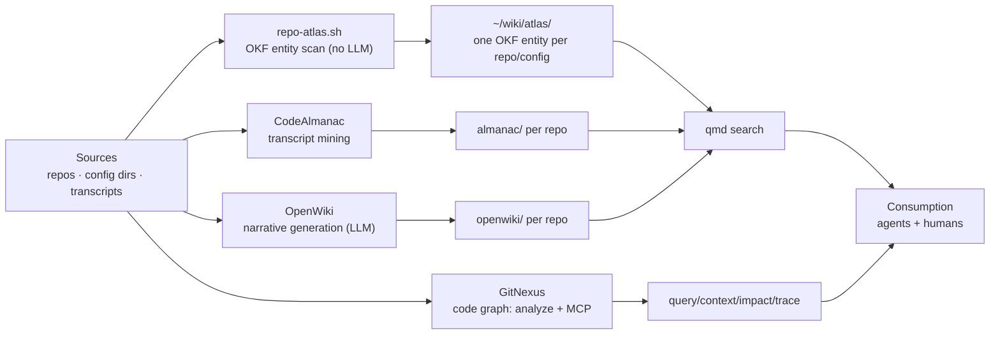

<p align="center"></p>

# atlas

A self-documenting map of your machine for AI agents. Every repo, agent harness,
MCP server and launchd service becomes a markdown entity in `~/wiki/atlas/`,
searchable with `qmd` and linked as a graph. Git hooks and launchd jobs keep it
current; you write zero docs.

**This repo = code and design. `~/wiki/atlas/` = generated output (data).**
Full design with C4/mermaid diagrams: [ARCHITECTURE.md](ARCHITECTURE.md).

> **Opinionated, macOS-only.** atlas assumes repos live under `~/dev/<category>/<repo>`,
> writes its bundle to `~/wiki/atlas/`, and schedules work with launchd. These paths
> are hardcoded on purpose. Making them configurable is possible but not done.



## Requirements

Versions are the ones atlas is tested with. Only the first block is required.

| Tool | Version | Needed for |
|---|---|---|
| macOS + launchd, python3, bash 4+ (Homebrew) | tested on macOS 26, bash 5 | everything; `repo-atlas.sh` needs bash 4+, the rest runs on `/bin/bash` 3.2 |
| [qmd](https://github.com/tobi/qmd) | 2.8.3 | search index over the bundle |
| [gh](https://cli.github.com) | 2.103 | repo visibility (LLM routing) and CI status in entity docs |
| git, jq | any recent | scans |
| [GitNexus](https://github.com/abhigyanpatwari/GitNexus) | 1.6.12 | code graph in the cascade (**PolyForm Noncommercial**, see [THIRD_PARTY.md](THIRD_PARTY.md)) |
| [OpenWiki](https://github.com/langchain-ai/openwiki) + node 22 at `~/.local/bin/node` | 0.9.0 | narrative wiki per repo (needs an LLM) |
| [CodeAlmanac](https://github.com/AlmanacCode/codealmanac) | 0.4.7 | decisions/pitfalls mined from agent transcripts |
| [LiteLLM](https://github.com/BerriAI/litellm) proxy | any | the LLM endpoint OpenWiki talks to |
| [pass](https://www.passwordstore.org) | 1.7 | where API keys come from (never literals) |
| [gitleaks](https://github.com/gitleaks/gitleaks), [prek](https://github.com/j178/prek) | 8.30 / 0.5 | pre-commit gate |
| [Entire](https://github.com/entireio/cli) | 0.13 | optional session checkpoints; hooks are no-ops unless a repo enables it |
| [deja](https://github.com/Giammarco-Ferranti/deja) | 0.24 | optional, `atlas friction` only |

Pinned versions the onboard step checks for drift: [.tool-pins/](.tool-pins).

## Install

```bash
git clone https://github.com/jrodeiro5/atlas-framework ~/dev/infra/atlas
ln -s ~/dev/infra/atlas/bin/atlas ~/.local/bin/atlas
atlas scan            # first scan, no LLM: writes ~/wiki/atlas/repos/*.md
atlas status
```

Read what `atlas scan` wrote before wiring anything automatic.

Then onboard repos one at a time. Onboarding sets `core.hooksPath` to this repo's
`hooks/`, so every commit in that repo starts the cascade in the background:

```bash
atlas onboard ~/dev/<category>/<repo>
atlas onboard ~/dev/<category>/<repo> --undo   # reversible
```

Scheduled scans (optional). The plists carry `__HOME__`/`__ATLAS__` placeholders:

```bash
for p in launchd/*.plist; do
  sed "s|__HOME__|$HOME|g; s|__ATLAS__|$PWD|g" "$p" > ~/Library/LaunchAgents/"$(basename "$p")"
  launchctl bootstrap gui/$(id -u) ~/Library/LaunchAgents/"$(basename "$p")"
done
```

nix-darwin users: declare the same three jobs as `launchd.user.agents` instead.
A rebuild reloads whatever it declares, so stop a job by removing its block, not
with `launchctl disable`.

## LLM configuration

Only OpenWiki uses an LLM. `scripts/openwiki-llm-env.sh` routes by **repo visibility**
(checked with `gh`); unknown visibility counts as private.

| Variable | Default | Meaning |
|---|---|---|
| `ATLAS_LLM_URL` | `http://localhost:4000` | LiteLLM (or any OpenAI-compatible) proxy |
| `ATLAS_LITELLM_KEY` | — | proxy key; export it from `pass`, never a literal |
| `ATLAS_MODEL_PUBLIC` | `atlas-public` | model for public repos |
| `ATLAS_MODEL_PRIVATE` | `atlas-private` | model for private repos; point it at a local model |
| `ATLAS_FALLBACK_URL` / `_KEY` / `_MODEL` | unset | public repos only, used when the proxy is down and all three are set |
| `ATLAS_HOST` | `hostname -s` | host name used in service entity docs |

Private repo with the proxy down: generation is **refused**, never sent to a cloud
fallback. Make sure your proxy has no global fallback for the private model either.

```bash
export ATLAS_LITELLM_KEY=$(pass atlas/litellm-key)
```

## What it writes, and where

| Path | Written by | Committed? |
|---|---|---|
| `~/wiki/atlas/**` | `atlas scan`, `atlas services` | not a repo; edit only below `<!-- manual -->` |
| `<repo>/openwiki/` | OpenWiki in the cascade | private/unknown remote: auto-committed by `atlas-cascade` with an `Atlas-Cascade:` trailer. Public remote: left as a diff for you to review |
| `<repo>/almanac/` | CodeAlmanac | by CodeAlmanac |
| `<repo>/CLAUDE.md` `<!-- atlas:start -->` block | `atlas pointer` | same rule as `openwiki/`; text outside the markers is never touched |
| `~/.local/state/atlas/runs/` | every run | run ledger (JSON), not in any repo |

Bot commits use a pathspec, so nothing you have staged ends up in them.

## Commands

`atlas help` lists them all. The main ones: `scan`, `services`, `onboard`, `cascade`,
`check` (read-only drift gate, exit 1 on any FAIL), `graph-check`, `status`.

## Principles

1. **Crawl, don't register:** scanners discover entities. Humans and agents only
   annotate exceptions below a `<!-- manual -->` marker.
2. **Frontmatter is the graph:** type + links in YAML frontmatter and plain markdown
   links. One entity per file, stable kebab-case slug = node ID.
3. **Agent-first output:** short pages, facts as lists. The cost of a wiki is the
   pages an agent reads, so atlas reads fewer pages rather than shorter ones.
4. **Generated output is never re-ingested as source:** `.openwikiignore` excludes
   `openwiki/`, `almanac/`, `.gitnexus/`, lockfiles and `.env*`.

Entity schema: [docs/entity-model.md](docs/entity-model.md).

## Glossary

- **Entity doc** — one markdown file per repo/service/harness under `~/wiki/atlas/`.
- **OKF** — the frontmatter format the entity docs follow (type, title, description, links).
- **Cascade** — the post-commit chain: `gitnexus analyze` → OpenWiki → `repo-atlas.sh` → `qmd update`.
- **Bundle** — the whole `~/wiki/atlas/` tree.
- **Run ledger** — one JSON manifest per atlas run, for "what is atlas doing right now".

## Tests

```bash
test/run-tests.sh   # stubbed tools, fake $HOME, no network, no LLM
```

## License

MIT — see [LICENSE](LICENSE). Third-party tools atlas drives keep their own
licenses: [THIRD_PARTY.md](THIRD_PARTY.md).
